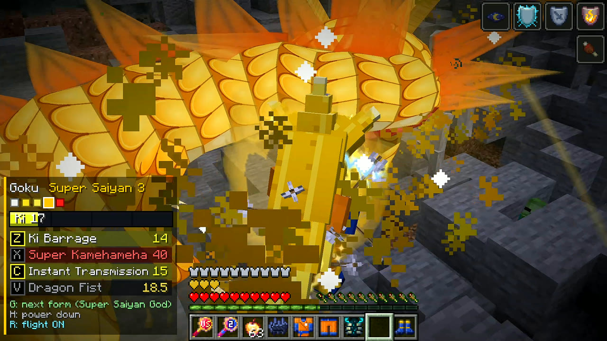
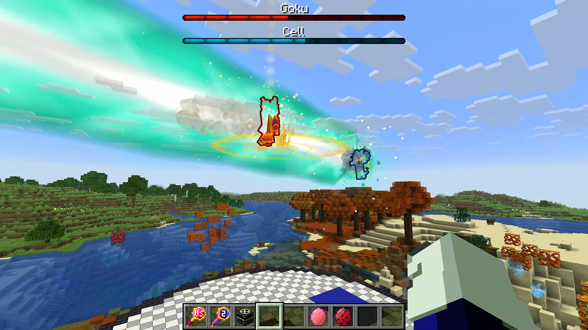
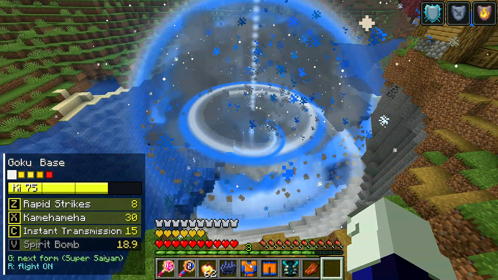
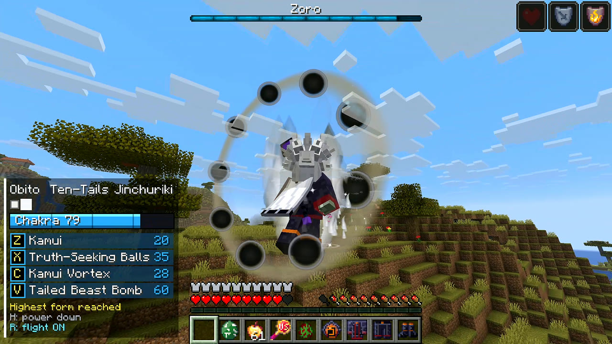

# Anime Clash: a parody anime fighters mod for Minecraft

A Minecraft mod with 18 anime fighters you can summon, set against each other, fight yourself, and beat to win their power armor.
Wear a full set and you get that fighter's moves, forms and (for some) flight.

It was made by **Claude Opus 5.5 (High effort)** for my YouTube videos *Opus 5.5 Low vs Opus 5.5 High: Who Made Better Anime Powers in Minecraft?*
A lot of you asked to play it, so here it is.






## Download

Get **animeclash-1.0.0.jar** from the [Releases](../../releases/latest) page.

## Requirements

| | |
|---|---|
| Minecraft | Java Edition **26.3** |
| Mod loader | **NeoForge 26.3.x** (made on 26.3.0.88, played in the videos on 26.3.0.94) |
| Other mods | None needed |
| Multiplayer | Install it on the server and on every player's game |

## How to install

**CurseForge app**
1. Create a custom profile: Minecraft 26.3, NeoForge (latest 26.3 version).
2. Open the profile's folder (the three dots next to Play, then *Open Folder*) and go into `mods`.
3. Drop `animeclash-1.0.0.jar` in there and press Play.

**Normal Minecraft launcher**
1. Install NeoForge for Minecraft 26.3 from [neoforged.net](https://neoforged.net/).
2. Put the jar in your `.minecraft/mods` folder and start the NeoForge profile.

## Quick start (30 seconds)

1. Make a **Creative** world with cheats on. **Superflat** in the daytime works best.
2. Open the creative tab **Anime Clash**: Fight Wand, Tag Team Wand, Arena Block, and for every fighter a summon item, a spawn egg and 4 armor pieces.
3. Type `/anime fight goku vegeta ssj ssj` and walk about 15 blocks back. After 3-2-1-FIGHT they battle on their own.
4. Want to *be* a fighter? `/anime give goku`, wear all 4 pieces, then use the keys below.
5. Between fights: `/anime stop` ends the fights, `/anime clear` removes all fighters.

## The 18 fighters

| Heroes | Villains |
|---|---|
| Goku, Vegeta, Saitama, Denji, Naruto, Sasuke, Luffy, Zoro | Frieza, Cell, Boros, Garou, Makima, Katana Man, Madara, Obito, Kaido, Doflamingo |

Every fighter is a boss with its own forms (49 in total, e.g. Goku goes Super Saiyan, 2, 3 and God) and 4 special moves per form (133 moves).
Fighters change form by themselves when their health drops.

## Playing as a fighter

Wear **all 4 pieces of the same fighter** (helmet, chestplate, leggings, boots).

| Key | What it does |
|---|---|
| **Z / X / C / V** | Moves 1-4 of your current form |
| **G** | Transform into the next form |
| **H** | Power down to base form |
| **R** | Toggle flight (fighters and forms that can fly) |

The keys can be changed in *Options > Controls > Anime Clash*. In survival, beat a fighter yourself to win its armor set and unlock the forms it reached.

## Fights

- **Fight Wand:** right-click one fighter (or any mob: Warden, Wither, Ender Dragon...), then a second one, and they fight 1v1.
- **Tag Team Wand:** pick 2 + 2 for a 2v2 (*Brawl* or *Tag* mode, sneak + right-click in the air to switch). Pick 3 and right-click the air for a 2v1.
- **Arena Block:** place it and right-click it, choose the fighters in the menu, and it builds an arena. Every block is put back after the fight.
- When two beams cross, they **clash**, and the stronger beam pushes through.

## Commands

All commands need cheats on (or op).

| Command | What it does |
|---|---|
| `/anime spawn <fighter> [form]` | Spawns a fighter in front of you (calm until you hit it) |
| `/anime fight <a> <b> [formA] [formB]` | A 1v1 with a countdown |
| `/anime tagteam <a> <b> <c> <d> [brawl\|tag]` | A 2v2: a + b against c + d |
| `/anime give <fighter\|all>` | Gives you a fighter's 4 armor pieces (or all of them) |
| `/anime unlockall` | Unlocks every form of every set for you |
| `/anime stop` | Ends all fights and arenas |
| `/anime clear` | Removes every fighter |
| `/anime list` | Lists all fighters |
| `/anime destruction [very_low\|low\|medium\|high\|super]` | How big the craters are (default medium) |

Fighter names for commands: `goku vegeta saitama denji naruto sasuke frieza cell boros garou makima katana_man madara obito luffy zoro kaido doflamingo`

Some fights to try:
```
/anime fight goku vegeta ssj2 ssj          Super Kamehameha vs Galick Gun beam clash
/anime fight luffy kaido gear5 dragon      Gear 5 vs the giant dragon (needs lots of space)
/anime fight saitama garou serious monster
/anime tagteam goku vegeta frieza cell tag
/anime destruction super                   the biggest craters
/gamerule mob_griefing false               no block damage at all
```

## Tips and known issues

- **Big moves destroy blocks.** Don't use this in a world you care about without a backup, or turn block damage off with `/gamerule mob_griefing false` or `/anime destruction very_low`.
- **Turn clouds off** (*Video Settings > Clouds*). Minecraft's clouds draw over the smoke and explosions.
- Creative players are ignored by fighters. Use **survival** to get attacked and win armor drops.
- Area moves hurt every creature nearby, villagers too.
- The biggest moves (Serious Punch, Spirit Bomb, *super* destruction) spawn a lot of effects and can lag weaker PCs. Lower your render distance if that happens.
- Multiplayer with several players and shader packs were never tested.

## Disclaimer

This is an **unofficial fan parody**. It is not affiliated with, endorsed by, or connected to the creators or owners of Dragon Ball, One Punch Man, Chainsaw Man, Naruto or One Piece.
All character names belong to their owners. All models, textures, effects and sounds in this mod are our own parody versions, made by code. Nothing was copied from the shows or games.
Not an official Minecraft product. Not approved by or associated with Mojang or Microsoft.

## License

All rights reserved. You're free to play it, record it and use it in your videos and streams (a link back here is appreciated).
Please don't re-upload the jar anywhere else. Link to this page instead.
